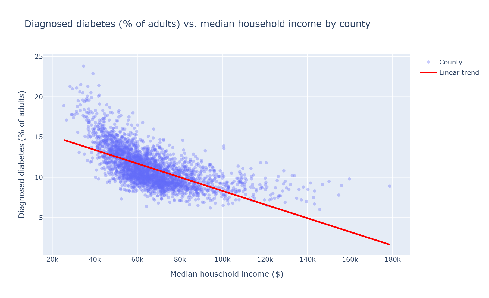
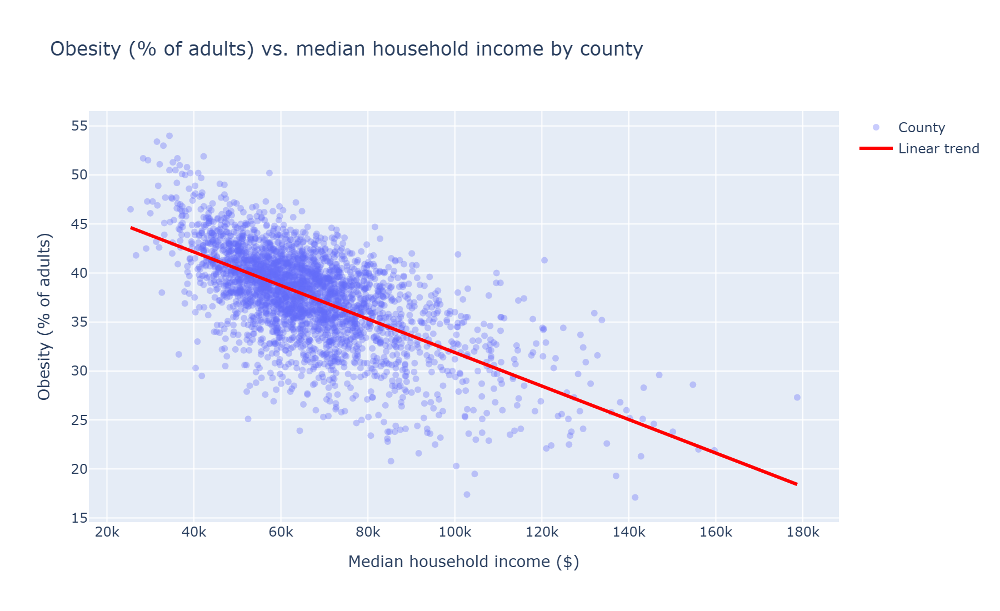
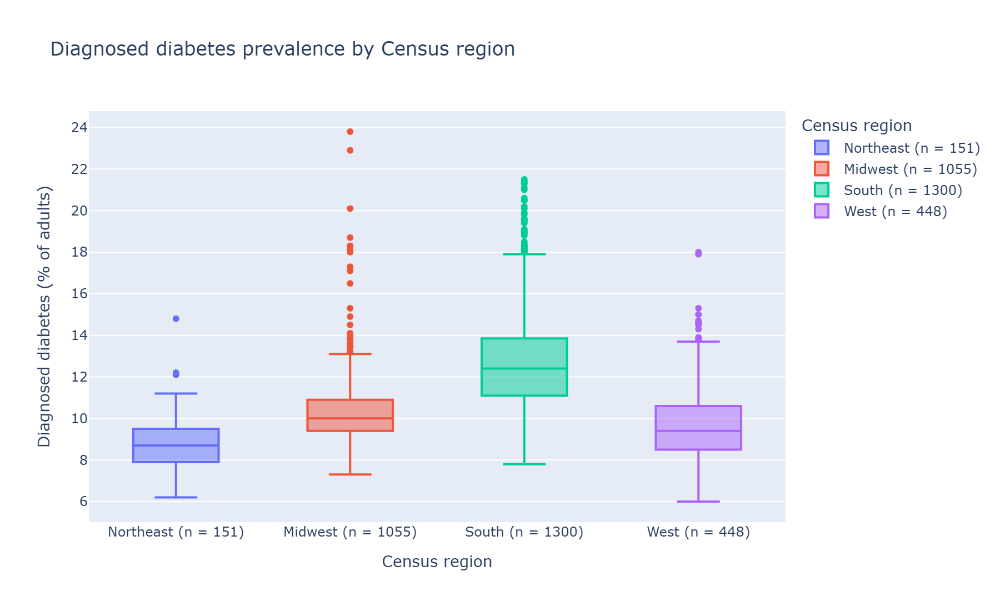
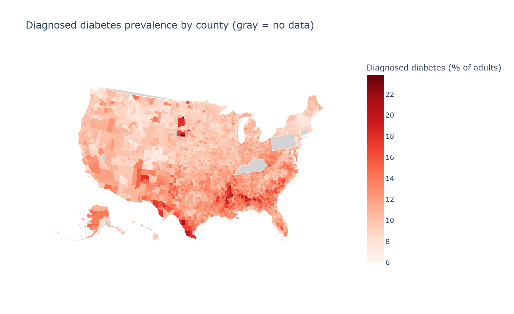
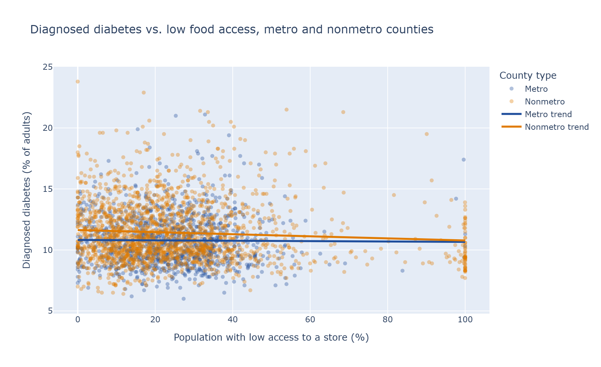
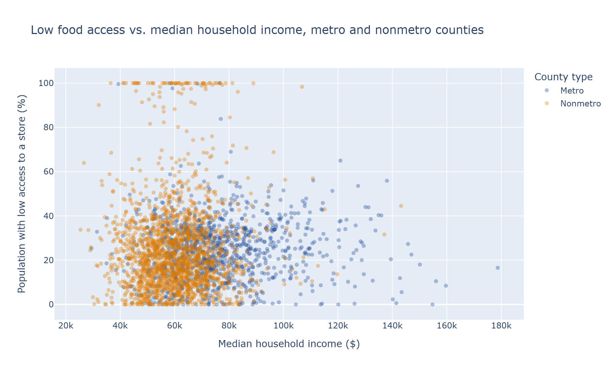

# Does Income Shape Health? County-Level Income, Obesity, and Diabetes in the U.S.

**Authors:** Alex Wang, Ryan Zhao

**GitHub repository:** [TODO: add public repository link]

---

## Summary of Research Questions

1. **How strongly does county median household income predict adult obesity and diagnosed diabetes prevalence?**
   We fit linear regressions of county diagnosed-diabetes prevalence and county obesity prevalence on median household income, using differences in income *across* counties at a single point in time (cross-sectional data, not change over time). The outcome is diagnosed diabetes of all types, as reported by CDC PLACES, rather than type 2 incidence specifically.

2. **Which counties are much healthier or much less healthy than their income predicts, and are those outliers geographically clustered?**
   Using the RQ1 diabetes model, we will compute each county's residual (actual minus predicted prevalence) and flag counties whose residual is more than 1.5 standard deviations of the residuals away from zero. We will then map the flagged counties to see whether they concentrate in particular parts of the country.

3. **Is the income–health relationship stronger in some U.S. regions than others?**
   We split counties into the four Census regions (Northeast, Midwest, South, West) and test whether the slope of diabetes on income differs by region with an interaction model, `DIABETES ~ income * C(region)`. Significant `income:region` terms (p < 0.05) would mean the income slope differs by region.

## Motivation

Obesity and diabetes are two of the most common and costly chronic diseases in the United States, and both are shaped by lifestyle factors, such as diet, physical activity, and access to care, that differ sharply with household income. We want to measure how large the income gap in health actually is at the county level, find the places that do much better or worse than their income would suggest, and see whether the gap is wider in some regions than others. If the relationship differs by region, income-based health programs may matter more in some places than others, and knowing where disparities are largest supports more targeted and equitable public-health action.

Because our data are cross-sectional and measured at the county level, our analysis describes associations, not causes, and county-level patterns do not necessarily hold for individual people (the ecological fallacy).

## Dataset

| Dataset | Source | What we use | Key |
|---|---|---|---|
| **CDC PLACES: Local Data for Better Health, County Data, 2025 release** | CDC | Age-adjusted prevalence of 11 health measures per county; diabetes (`DIABETES`) and obesity (`OBESITY`) are the outcomes for our research questions | `LocationID` (5-digit county FIPS) |
| **Census ACS 2019–2023 5-year estimates, Subject Table S1901** | U.S. Census Bureau API | `S1901_C01_012E`: median household income (dollars) per county | `state` + `county` codes, combined into a 5-digit FIPS |
| **USDA Food Environment Atlas, 2025** | USDA Economic Research Service | 26 county variables on food access, store and restaurant density, poverty, demographics, and metro status | `FIPS` |
| **U.S. county boundaries (GeoJSON)** | plotly datasets repository | County shapes for maps | 5-digit FIPS |

The PLACES values are model-based estimates derived from the CDC's Behavioral Risk Factor Surveillance System (BRFSS) survey, not direct measurements in every county. Kentucky and Pennsylvania are not included in the 2025 release for measures based on 2023 BRFSS data (including diabetes and obesity), because neither state collected enough months of data to be included in the 2023 BRFSS annual dataset.

We replaced the Census TIGER boundary file listed in our proposal with a county GeoJSON file, because plotly can draw it directly by FIPS code without any extra mapping library.

## Method

All steps are written as runnable Python scripts that use the main method pattern.

1. **Cleaning (`clean_data.py`).**
   - *Census:* the API returns a JSON list of lists in which the first row is the header and every value is a string. We convert income to numbers, build a 5-digit FIPS code from the state and county codes, and replace the Census "no estimate" codes (such as `-666666666`) with missing values.
   - *PLACES:* we read the 60 MB file in chunks, keep only the rows for our 11 measures with `DataValueTypeID == 'AgeAdjPrv'` (age-adjusted prevalence, so counties with older populations are compared fairly), and reshape from one row per county *per measure* to one row per county.
   - *Food Atlas:* we read the 38 MB long-format file in chunks, keep only the 26 variables listed in `VariableList_cleaned.csv`, replace the Atlas's missing-value codes (`-9999`, `-8888`) with missing values, and reshape to one row per county.
   - All FIPS codes are kept as 5-character strings so that codes such as `01001` keep their leading zero.
2. **Joining (`join_data.py`).** We inner-join Census income with PLACES on FIPS (`census_places`) and then join that result with the Food Atlas (`census_places_food`). We add a `region` column from each county's state code, using the Census Bureau's four regions. The script prints the counties that fail to match on each side so we can explain every dropped row.
3. **Summary statistics (`eda.py`).** For each dataset and each joined combination, we report the size, missing values per column, a seven-number summary of each quantitative variable of interest (using `DataFrame.describe`), and value counts for each categorical variable of interest.
4. **Visualizations (`visualize.py`).** We use plotly to create scatter plots with least-squares trend lines, box plots by region, and a county map (choropleth). The figures use the 2,954 counties that have both income and diabetes values. All figures are saved as PNG files in `figures/`.

**Changes since the proposal:**
- RQ2 now uses residuals from the RQ1 model, rather than distance from the mean prevalence, so that it identifies counties that differ from what their income predicts.
- Because diabetes falls off more slowly at higher incomes (Figure 1), we will also fit RQ1 with the logarithm of income: its correlation with diabetes is stronger (r = −0.70) than raw income's (r = −0.64).
- We added the Food Atlas join as an extension that checks whether food access is related to diabetes separately from income.

## EDA Results

Because we are pursuing the **Multiple Datasets** challenge goal, we report EDA for each joined combination we use. We also give the size and missing data of each source dataset for context.

### How the datasets are related

All three datasets describe U.S. counties and share the 5-digit county FIPS code, which we use as the join key. Census provides the explanatory variable (income), PLACES provides the outcomes (diabetes, obesity), and the Food Atlas adds food environment and county-type variables for the extension. We use two joined combinations:

- **Census + PLACES** (`census_places`): used for RQ1, RQ2, and RQ3.
- **Census + PLACES + Food Atlas** (`census_places_food`): used for the food access extension.

### Dataset size

| Dataset | Rows | Columns | One row represents |
|---|---|---|---|
| Census income (source) | 3,222 | 5 | A county or county-equivalent, including Puerto Rico |
| PLACES health (source) | 2,957 | 14 | A county with PLACES estimates |
| Food Atlas (source) | 3,156 | 29 | A county (including some that no longer exist) |
| **Census + PLACES** | **2,957** | **18** | A county present in both datasets |
| **Census + PLACES + Food Atlas** | **2,957** | **44** | A county present in all three datasets |

**Columns of Census + PLACES:** `FIPS`, `NAME` (county and state name), `STATE_FIPS`, `COUNTY_FIPS`, `MEDIAN_HH_INCOME_2023`, `StateAbbr`, the 11 age-adjusted PLACES measures (percent of adults: `DIABETES`, `OBESITY`, `BPHIGH`, `CHD`, `CSMOKING`, `LPA`, `ACCESS2`, `CHECKUP`, `GHLTH`, `MHLTH`, `DEPRESSION`), and `region`. **Census + PLACES + Food Atlas** adds the 26 Food Atlas variables, such as `PCT_LACCESS_POP19`, `GROCPTH20`, `FFRPTH20`, and `METRO23`.

**Rows lost when joining:** 265 Census rows have no PLACES match: all 120 Kentucky counties and all 67 Pennsylvania counties (not in the 2025 PLACES release, as explained in the Dataset section), 78 Puerto Rico municipios (not covered by PLACES). Every county in Census + PLACES also matched the Food Atlas. The 199 Food Atlas rows without a match are the same Kentucky and Pennsylvania counties, plus Connecticut's 8 former counties and a few Alaska counties whose codes have since changed.

### Missing data

We counted missing values with `DataFrame.isna().sum()` per column and `DataFrame.isna().any(axis=1).sum()` per row (`eda.py`, `missing_summary`). These counts are taken after the cleaning step converted each dataset's missing-value codes to `NaN`, so the codes are not mistaken for real values.

**Census + PLACES:** 3 of 2,957 rows (0.10%) have any missing value:
- 2 counties have no income estimate (Esmeralda County, NV, and Kenedy County, TX), coded `-666666666` by the Census.
- 1 county has no estimate for any of the 11 PLACES measures.

*Plan:* drop these 3 rows from the analysis, which leaves 2,954 counties. Dropping 0.1% of rows will not meaningfully change our results.

**Census + PLACES + Food Atlas:** 2,356 of 2,957 rows (79.7%) have at least one missing value. Almost all of these gaps come from a few store and facility columns:

| Column | Missing | % missing |
|---|---|---|
| `SUPERCPTH20` (supercenters per 1,000 people) | 2,330 | 78.8% |
| `RECFACPTH20` (recreation and fitness facilities per 1,000) | 1,748 | 59.1% |
| `GROCPTH20` (grocery stores per 1,000) | 874 | 29.6% |
| `FFRPTH20` (fast-food restaurants per 1,000) | 468 | 15.8% |
| `PCT_LACCESS_POP19` (population with low access to a store) | 11 | 0.37% |
| Every other column | ≤ 33 | ≤ 1.1% |

No county shows zero grocery stores, which suggests that these gaps are suppressed small counts. If so, they are concentrated in small, rural counties rather than missing at random. *Plan:* we will not use `SUPERCPTH20` or `RECFACPTH20`. We will use `PCT_LACCESS_POP19` as our main food access variable because it is nearly complete, and we will drop the few rows where it is missing. Any analysis that uses `GROCPTH20` or `FFRPTH20` will note that it covers only counties with reported values.

[TODO: confirm in the Food Atlas documentation what the `-9999` code means; the documentation says `-8888` marks counties that did not exist in a given year.]

### Variables of interest

| Column | Meaning | Type | Why we use it |
|---|---|---|---|
| `MEDIAN_HH_INCOME_2023` | County median household income in dollars (ACS 2019–2023) | Quantitative | The explanatory variable in all three research questions |
| `DIABETES` | Age-adjusted % of adults with diagnosed diabetes | Quantitative | Outcome for RQ1, RQ2, and RQ3 |
| `OBESITY` | Age-adjusted % of adults with obesity (BMI ≥ 30) | Quantitative | Second outcome for RQ1 |
| `region` | Census region (Northeast, Midwest, South, West) | Categorical | Groups counties for RQ3; describes outlier locations for RQ2 |
| `FIPS` | 5-digit county code | Identifier | Join key; locates counties on the RQ2 map |
| `PCT_LACCESS_POP19` | % of population with low access to a grocery store (2019) | Quantitative | Food access extension |
| `GROCPTH20`, `FFRPTH20` | Grocery stores and fast-food restaurants per 1,000 people (2020) | Quantitative | Food environment extension |
| `METRO23` | Metro or nonmetro county (2023) | Categorical | Separates urban and rural counties, whose food access differs |

### Summary of variables of interest

**Census + PLACES** (Census and PLACES values shown here match the source datasets, except income, which differs because Puerto Rico, Kentucky, and Pennsylvania are not in the join):

| Variable | Mean | Std. dev. | Min | Q1 | Median | Q3 | Max |
|---|---|---|---|---|---|---|---|
| `MEDIAN_HH_INCOME_2023` ($) | 66,405.57 | 17,447.28 | 25,425 | 55,262.50 | 64,017 | 74,010 | 178,707 |
| `DIABETES` (%) | 11.17 | 2.33 | 6.0 | 9.5 | 10.7 | 12.5 | 23.8 |
| `OBESITY` (%) | 37.63 | 4.74 | 17.1 | 35.1 | 38.2 | 40.6 | 54.0 |

| `region` | Count |
|---|---|
| South | 1,302 |
| Midwest | 1,055 |
| West | 449 |
| Northeast | 151 |

**Census + PLACES + Food Atlas** (income, diabetes, and obesity are the same as above):

| Variable | Mean | Std. dev. | Min | Q1 | Median | Q3 | Max |
|---|---|---|---|---|---|---|---|
| `PCT_LACCESS_POP19` (%) | 24.99 | 18.78 | 0.00 | 12.45 | 22.13 | 32.77 | 100.00 |
| `GROCPTH20` (per 1,000) | 0.23 | 0.18 | 0.04 | 0.13 | 0.18 | 0.26 | 2.34 |
| `FFRPTH20` (per 1,000) | 0.68 | 0.29 | 0.15 | 0.51 | 0.65 | 0.79 | 6.68 |

| `METRO23` | Count |
|---|---|
| Nonmetro | 1,843 |
| Metro | 1,113 |
| Missing | 1 |

All of these tables are produced by `eda.py` and saved as CSV files in `results/`.

### Visualizations: Census + PLACES

**Figure 1.** *Counties with higher median household income have lower diagnosed diabetes prevalence, but the decline flattens at high incomes.*

Figure 1 plots each county's diagnosed-diabetes prevalence against its median household income, with a least-squares trend line. We chose a scatter plot because both variables are quantitative and RQ1 asks how strongly one predicts the other. The relationship is clearly negative (Pearson r = −0.64, so income alone accounts for about 40% of the variation in diabetes across counties), and the trend line drops by about 0.85 percentage points for every $10,000 of income. The points curve, however: diabetes falls steeply among low-income counties and levels off near 8–9% above about $100,000, where the straight line predicts values that are too low. This suggests modeling RQ1 with the logarithm of income, which has a stronger correlation (r = −0.70).

**Figure 2.** *Obesity prevalence also declines steadily as county income rises, with more spread among high-income counties.*

Figure 2 repeats Figure 1 for obesity, the second outcome in RQ1. The relationship is about as strong as for diabetes (r = −0.63, about 40% of the variation explained) and closer to a straight line, with obesity about 1.7 percentage points lower for every additional $10,000 of median income. The spread around the line is wide, especially above $80,000, which means income alone leaves much of the county-to-county variation in obesity unexplained.

**Figure 3.** *Southern counties have markedly higher diabetes prevalence than counties in the other three regions.*

Figure 3 shows a box plot of county diabetes prevalence for each Census region, with the number of counties in each region in the axis labels. We chose box plots because they compare the center, spread, and outliers of a quantitative variable across the categories of `region`, which RQ3 compares. The South's median (12.4%) is about 2–4 percentage points higher than the Midwest (10.0%), West (9.4%), and Northeast (8.7%), and the South also has the widest spread and the most high outliers. The regions also differ in size: the Northeast has only 151 counties because Pennsylvania is missing, which RQ3 must account for. As a first look at RQ3, the correlation between income and diabetes within each region is strongest in the South (r = −0.68) and weakest in the Northeast (r = −0.40).

**Figure 4.** *High diabetes prevalence is geographically clustered, especially across the Deep South, south Texas, and parts of South Dakota.*

Figure 4 colors each county by diagnosed-diabetes prevalence; gray counties have no data. We chose a map because RQ2 asks whether outlier counties cluster geographically, and a map shows spatial patterns that a scatter plot cannot. High-prevalence counties form clear clusters: a band through Mississippi, Alabama, and Georgia, the Texas–Mexico border region, and a few counties in South Dakota. Kentucky and Pennsylvania appear in gray, showing exactly where data are missing. In RQ2 we will map the residuals from the RQ1 model rather than the raw prevalence, to see whether these clusters remain after accounting for income.

### Visualizations: Census + PLACES + Food Atlas

**Figure 5.** *Low food access has almost no relationship with diabetes prevalence, in either metro or nonmetro counties.*

Figure 5 plots diabetes prevalence against the percentage of each county's population with low access to a grocery store, colored by metro status, with a separate trend line for each group. We split by `METRO23` because "low access" is defined by distance, which means something different in cities than in rural areas. Both trend lines are nearly flat (overall r = −0.05), and nonmetro counties have slightly higher diabetes at most levels of access. A column of rural counties sits at 100% low access, meaning the entire population lives far from a store. The takeaway is that, by this measure, distance to a store does not explain diabetes on its own, so food access is unlikely to account for much of the income–diabetes relationship.

**Figure 6.** *Low food access is not related to county income; higher-income counties are mostly metro counties.*

Figure 6 plots low food access against median household income, colored by metro status. We made this plot to check whether food access and income measure the same thing; if they did, adding food access to an income model would add little new information. They are essentially uncorrelated (r = 0.02). The plot also shows that most counties above about $90,000 are metro counties, while the 100% low-access counties are almost all nonmetro, so metro status is worth including as a control in later models.

## Challenge Goals Update

- **Messy Data (on track).** The Census income data comes from an API as a JSON list of lists, with a header row, string values, and numeric codes for missing estimates. The PLACES and Food Atlas files are in long format, the Food Atlas uses its own missing-value codes (`-9999`, `-8888`), and both files are large enough that we read them in chunks. `clean_data.py` handles all of this reproducibly.
- **Multiple Datasets (on track).** We join three datasets on county FIPS. Every research question uses at least two (Census and PLACES), and the food access extension uses all three. We document every row lost in each join and why.
- **New Library (partly changed).** We use plotly for all figures, including the county map. We still plan to use statsmodels for the RQ1 regressions, the RQ2 residuals, and the RQ3 interaction model. However, on one of our computers, Windows Smart App Control blocks a compiled file inside scipy, which statsmodels requires. [TODO: say how this will be resolved, e.g., running the statsmodels analysis on the other teammate's computer, or changing the security setting.] For the EDA we drew the trend lines with numpy's least-squares fit, which does not need scipy.

## Work Plan Evaluation

Our proposal estimated 6 hours for loading, cleaning, and graphing; 8 hours for finding relationships; 5 hours for answering the questions; and 1 hour to finish and present.

[TODO: fill in how many hours loading, cleaning, and EDA actually took and why the estimate was close or far off. Things that took unplanned time: the Census API's format, discovering that Kentucky and Pennsylvania are missing from PLACES, finding the Food Atlas missing-value codes, the reshaping steps, and getting plotly's image export working.]

**Remaining tasks and estimates:** [TODO: adjust]
- RQ1 regressions (linear and log income) and interpretation: ~4 hours
- RQ2 residuals, flagging outliers, and the residual map: ~4 hours
- RQ3 interaction model and regional plots: ~4 hours
- Tests for the analysis code: ~3 hours
- Final report and presentation: ~5 hours

## Testing

[TODO: complete after the test module is written. Planned approach: `test_eda.py` runs the cleaning, joining, and summary functions on small hand-made inputs whose correct outputs we worked out by hand, and checks them with assert statements. For example, it checks that Census missing codes become NaN, that FIPS codes keep their leading zeros, that the reshaping keeps a county whose values are all missing, that the join drops exactly the expected unmatched counties, that every state code maps to the correct region, and that the missing-value counts and seven-number summary match hand-computed values. We also checked our results visually: the county map shows exactly the expected gaps for Kentucky and Pennsylvania, and the summary statistics fall within realistic ranges, for example no negative percentages.]

## Collaboration

[TODO: list the people and resources you consulted besides course staff and teammates, for example: the CDC PLACES, Census API, and USDA Food Environment Atlas documentation; the pandas and plotly documentation; and any AI tools you used and what you used them for.]

---

## Appendix: Sources

- CDC PLACES current release notes: https://www.cdc.gov/places/current-release-notes/
- CDC PLACES County Data, 2025 release: https://catalog.data.gov/dataset/places-local-data-for-better-health-county-data-2025-release-e4b8f
- Census ACS 5-year Subject Tables API: https://api.census.gov/data/2023/acs/acs5/subject
- USDA ERS Food Environment Atlas documentation: https://www.ers.usda.gov/data-products/food-environment-atlas/documentation
- CDC Census region definitions: https://www.cdc.gov/nchs/hus/sources-definitions/geographic-region.htm
- County GeoJSON: https://raw.githubusercontent.com/plotly/datasets/master/geojson-counties-fips.json
